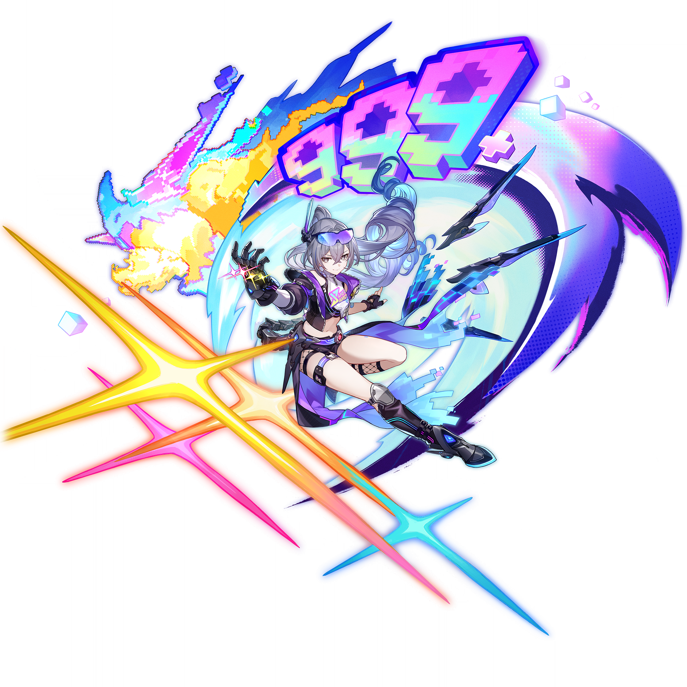

# dsh-silverwolf-theme · 银狼LV.999 主题

[](LICENSE)
[](https://github.com/qiyuelianfeng/dsh-silverwolf-theme)

把 DSH Web GUI 换成《崩坏：星穹铁道》银狼LV.999（Silver Wolf LV.999，星核猎手 · 超级骇客的欢愉赛季 SP 形态）的银白赛博渐变毛玻璃主题，把 agent 的人格设定改成银狼LV.999——人格提示词可以直接在侧边栏里改——把新会话欢迎页换成她，顺手把输入框的默认提示换成她的话，还能把整页背景换成 `Background/` 里的壁纸（面板里开关、选起点、自动轮换、上传自定义；深色模式自动切换）。

> **English** — A silver-white cyber frosted-glass skin for the DSH Web GUI, themed after Silver Wolf LV.999 from *Honkai: Star Rail*. It also rewrites the agent persona (editable from the sidebar), replaces the new-session hero fish with her, and adds a full-page background manager (enable / pick / rotate / fade the image, upload your own).
>
> Install: `dsh plugin --profile desktop add github:qiyuelianfeng/dsh-silverwolf-theme` — then reload the page. UI text is Chinese.
>
> **Unofficial fan project.** Silver Wolf LV.999 and all *Honkai: Star Rail* character art, names and assets are © miHoYo / HoYoverse, used here as non-commercial fan work. Not affiliated with or endorsed by miHoYo, HoYoverse or DeepSeek — see 「版权与致谢」 below.

## 能力

| 部分 | 实现 |
| --- | --- |
| 主题 UI | 客户端半注入作用域化样式表（`body[data-dsh-silverwolf][data-silverwolf-skin="on"]`）：银白/蓝紫赛博渐变、半透明表面 token、`backdrop-filter` 毛玻璃、蓝色描边与柔和阴影、蓝色滚动条/选区。全部随插件卸载自动还原。 |
| 人格设定 | 宿主半注册 `systemPrompt.section({ name: 'silverwolf:persona', ... })`——人格底稿为银狼LV.999（慵懒毒舌的满级骇客，欢愉命途 · 虚数属性）。侧边栏可编辑，改完立即对之后每一轮对话生效。 |
| 背景图 | 随包 `Background/`（含银狼LV.999 壁纸）+ 面板上传 `backgrounds-custom/`。面板里开关、选起点、自动轮换、淡化浓度、上传/删除；深色模式自动切换。 |
| 长期记忆 | 存在 `$DSH_HOME/silverwolf-memory.json`，工具 `silverwolf_memory_add / search / forget`，独立 section 注入系统提示词。 |
| 世界书 | 设定库存在 `$DSH_HOME/silverwolf-worldbook.json`，工具 `silverwolf_worldbook_search` 检索。面板里可**从 BWIKI（wiki.biligame.com/sr）一键抓取**「银狼 / 银狼LV.999」的档案、故事、简介。 |

## 安装

从 GitHub（推荐）：

```powershell
dsh plugin --profile desktop add github:qiyuelianfeng/dsh-silverwolf-theme
```

从本地目录（开发时就地改）：

```powershell
dsh plugin --profile desktop add D:\path\to\dsh-silverwolf-theme
```

`--profile` 换成你自己的 profile 名（Web 端一般是 `web`，桌面端是 `desktop`）。

装完刷新一次页面：客户端半的 bundle 是页面加载时读的，不刷新还是旧的。

卸载：`dsh plugin --profile desktop remove dsh-silverwolf-theme`。

## 截图

欢迎页立绘与背景壁纸（银狼LV.999 素材，网络搜集，仅作展示）：

| 欢迎页立绘 | 背景壁纸 |
| --- | --- |
|  |  |

> 插件市场用的截图清单在仓库根的 [`screenshots.json`](screenshots.json)（第一张为封面）。

## 使用

1. 安装后刷新一次 DSH 页面——客户端半是新 bundle，不刷新不会加载。
2. 侧边栏最下方、设置按钮旁边点「✦ 银狼」打开人格设定面板（Esc 或右上角 ✕ 关闭）。
3. 也可以在「设置 → 银狼 · 主题」里打开同一份编辑器；标题右边的版本号读的是 `package.json`。
4. 编辑框里写的就是人格底稿——内置默认就是银狼LV.999（语气 / 边界 / 参考回答格式三段，嫌啰嗦可以直接删掉再用）；点「保存设定」后，之后每一轮对话都会以这段设定回答。
5. 下面一行「✦ 背景图管理」是背景的唯一入口：最上面「浅色 / 深色」切整个应用外观；「背景图 / 简约（无图）」二选一；上传一张自己的图；点缩略图设为起点；自动轮换（间隔 15–600 秒）；淡化浓度（0.2–0.85）；自己传的那几张角上有「删除」。
6. 再下面「✦ 长期记忆」：启用开关、搜索、手动加一条、删单条、清空。平时不用管它——模型觉得该记的会自己调 `silverwolf_memory_add` 写进来，需要翻旧事时自己调 `silverwolf_memory_search`。
7. 再下面「✦ 世界书」：点「从官方 wiki 抓取」一键拉取「银狼 / 银狼LV.999」的档案、故事、简介（几秒钟）；模型需要设定时自己调 `silverwolf_worldbook_search` 查。

### 改完之后什么时候生效

| 改的是什么 | 生效方式 |
| --- | --- |
| 人格底稿 / 背景设定（在面板里保存） | **立刻**，之后每一轮对话都按新设定 |
| `lib/client.js`（样式表、面板本身） | 刷新页面（F5） |
| `lib/index.js`（路由、section 逻辑） | 重载插件行或重启 DSH |
| `Background/` 里加图 / 删图 / 改名 | 刷新页面即可 |
| 面板里上传 / 删除背景图、切浅色 / 深色外观 | 立刻 |

## 状态文件

```json
{ "persona": "……人格提示词……", "enabled": true, "theme": true,
  "hero": { "image": "meme/hero-silverwolf.png", "title": "LV999 的银狼，来当你的外挂" },
  "background": { "enabled": true, "current": "", "rotate": false, "interval": 90, "dim": 0.6 },
  "rev": 3 }
```

- `persona`：空字符串表示不注入人格。
- `enabled`：人格总开关。
- `theme`：银白赛博主题开关（关掉只留人格，UI 回到原样）。
- `hero`：新会话欢迎页的形象路径（相对插件目录）与欢迎语。
- `background`：整页背景。`enabled` 总开关、`current` 起点文件名（空串＝按目录顺序第一张）、`rotate` 自动轮换、`interval` 轮换间隔秒数（15–3600）、`dim` 色纱浓度（0.2–0.85，越大越淡）。
- `rev`：写入版本号，每次成功写入 +1。

出问题时最快的还原手段：删掉这个文件并重载插件行，人格回到内置默认、主题按默认值。

**长期记忆不在这里**：单独存在同一个目录下的 `silverwolf-memory.json`，删掉它就等于清空记忆，主题设定一点不受影响。

**世界书也不在这里**：`silverwolf-worldbook.json` 是设定库本体，删掉等于清空库，人格、记忆、主题设定都不动。

## 素材说明

- **欢迎页立绘**：`meme/hero-silverwolf.png` 是银狼LV.999 立绘（2048×2048 透明 PNG）。
- **背景图**：`Background/silverwolf-lv999-art.jpg` 是银狼LV.999 壁纸（2973×1409，网络搜集）。

> 上述立绘/壁纸素材搜集自网络，版权归原作者与 © miHoYo / HoYoverse 所有，仅作非商用同人使用。**如有素材涉及侵权，请通过仓库 Issues 告知，核实后将立即删除。** 如需自用其他立绘，替换对应文件即可。

## 数据来源与免责

- **世界书抓取**：`build-worldbook.mjs` 与世界书面板里的「从官方 wiki 抓取」功能，数据抓取自 **BWIKI（wiki.biligame.com/sr）** 的公开角色页。这是**非官方**行为，仅供个人学习与检索使用；请勿高频抓取、勿将抓取内容商用，并遵守目标站点的使用条款与 `robots.txt`。
- **角色设定与美术**：Silver Wolf LV.999 等角色名、设定文本、立绘、壁纸的版权归原作者与 **© miHoYo / HoYoverse** 所有。本作是**非官方同人项目**，与 miHoYo、HoYoverse、DeepSeek 均无隶属或合作关系。**若发现任何内容侵犯了您的权益，请通过仓库 Issues 告知，我们将及时处理。**

## 版权与致谢

- **参考模组**：[berhbro/dsh-cyrene-theme](https://github.com/berhbro/dsh-cyrene-theme)（昔涟 · Cyrene 主题，MIT License）——本作沿用了其整体架构，只把人物、配色、文案替换为「银狼LV.999」。
- 本项目以 MIT License 发布，见 [LICENSE](LICENSE)。
- Silver Wolf LV.999、Honkai: Star Rail © miHoYo / HoYoverse
