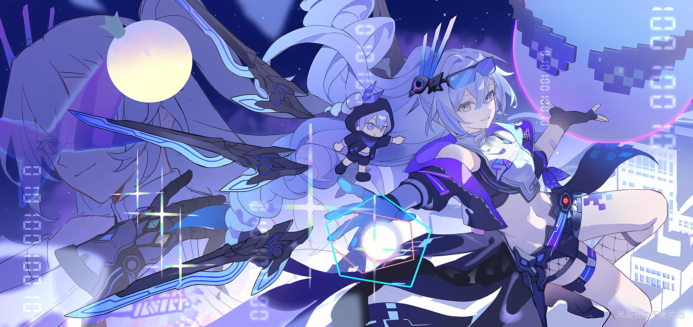

# dsh-silverwolf-theme · 银狼 LV.999 主题

[](LICENSE)
[](https://github.com/qiyuelianfeng/dsh-silverwolf-theme)
[](package.json)

把 DSH Web GUI 换成《崩坏：星穹铁道》银狼LV.999（Silver Wolf LV.999，星核猎手 · 超级骇客的欢愉赛季 SP 形态）的银白赛博渐变毛玻璃主题，把 agent 的人格设定改成银狼LV.999——人格提示词可以直接在侧边栏里改——把新会话欢迎页换成她，顺手把输入框的默认提示换成她的话，还能把整页背景换成 `Background/` 里的壁纸（面板里开关、选起点、自动轮换、上传自定义；深色模式自动切换）。

> **非官方同人项目。** Silver Wolf LV.999 与《崩坏：星穹铁道》相关角色名、设定、美术均为 © miHoYo / HoYoverse 所有，本作仅作非商用同人使用，与 miHoYo、HoYoverse 或 DeepSeek 无关。
>
> 本项目**参考/改编自昔涟（Cyrene）主题模组 [berhbro/dsh-cyrene-theme](https://github.com/berhbro/dsh-cyrene-theme)**（MIT License）——原模组把《崩坏：星穹铁道》角色「昔涟」（Cyrene）做成 DSH 主题，本作沿用了其整体架构（宿主半人格注入 + fenced 路由状态持久化 + 客户端半作用域化样式表 + 背景图/长期记忆/世界书管理），只把人物、配色、文案替换为「银狼LV.999」。

## 能力

| 部分 | 实现 |
| --- | --- |
| 主题 UI | 客户端半注入作用域化样式表（`body[data-dsh-silverwolf][data-silverwolf-skin="on"]`）：银白/蓝紫赛博渐变、半透明表面 token、`backdrop-filter` 毛玻璃、蓝色描边与柔和阴影、蓝色滚动条/选区。全部随插件卸载自动还原。 |
| 人格设定 | 宿主半注册 `systemPrompt.section({ name: 'silverwolf:persona', ... })`，人格底稿为银狼LV.999（慵懒毒舌的满级骇客，欢愉命途 · 虚数属性），侧边栏可编辑，改完立即对之后每一轮对话生效。 |
| 背景图 | 随包 `Background/`（含银狼LV.999 官方壁纸）+ 面板上传 `backgrounds-custom/`，支持开关、选起点、轮换、淡化、上传/删除。 |
| 长期记忆 | 存在 `$DSH_HOME/silverwolf-memory.json`，工具 `silverwolf_memory_add / search / forget`，独立 section 注入。 |
| 世界书 | 设定库存在 `$DSH_HOME/silverwolf-worldbook.json`，工具 `silverwolf_worldbook_search` 检索。面板里可**从 BWIKI（wiki.biligame.com/sr）一键抓取**「银狼 / 银狼LV.999」两个角色的档案、故事、简介。**数据抓取为非官方行为，仅供个人学习使用，请勿高频抓取或商用**。 |

## 安装

### 从 GitHub 安装（推荐）

```powershell
dsh plugin --profile desktop add github:qiyuelianfeng/dsh-silverwolf-theme
```

> 把 `--profile desktop` 换成你自己的 profile 名（Web 端一般是 `web`，桌面端是 `desktop`）。

### 从本地目录安装（开发用）

```powershell
dsh plugin --profile desktop add D:\path\to\dsh-silverwolf-theme
```

装完刷新一次页面（客户端半 bundle 是页面加载时读的）。

卸载：`dsh plugin --profile desktop remove dsh-silverwolf-theme`。

## 截图

欢迎页立绘与背景壁纸（均为银狼LV.999 官方素材）：

| 欢迎页立绘 | 背景壁纸 |
| --- | --- |
|  |  |

> 插件市场用的截图清单在仓库根的 [`screenshots.json`](screenshots.json)（第一张为封面）。

## 使用

1. 安装后刷新一次 DSH 页面。
2. 侧边栏最下方、设置按钮旁边点「✦ 银狼」打开人格设定面板（Esc 或右上角 ✕ 关闭）。
3. 也可以在「设置 → 银狼 · 主题」里打开同一份编辑器；标题右边的版本号读的是 `package.json`。
4. 编辑框里写的就是人格底稿——内置默认是银狼LV.999（慵懒毒舌的满级骇客）；点「保存设定」后，之后每一轮对话都会以这段设定回答。
5. 「✦ 背景图管理」是背景的唯一入口：浅色/深色外观、上传、选起点、自动轮换、淡化浓度。
6. 「✦ 长期记忆」：模型用 `silverwolf_memory_add / search / forget` 读写，也可以手动加、删、清空。
7. 「✦ 世界书」：点「从官方 wiki 抓取」一键拉取「银狼 / 银狼LV.999」的档案、故事、简介，模型用 `silverwolf_worldbook_search` 检索。

## 素材说明

- **欢迎页立绘**：`meme/hero-silverwolf.png` 是银狼LV.999 立绘（2048×2048 透明 PNG）。
- **背景图**：`Background/silverwolf-lv999-art.jpg` 是银狼LV.999 壁纸（2973×1409，网络搜集）。

> 上述立绘/壁纸素材搜集自网络，版权归原作者与 © miHoYo / HoYoverse 所有，仅作非商用同人使用。**如有素材涉及侵权，请通过仓库 Issues 告知，核实后将立即删除。** 如需自用其他立绘，替换对应文件即可。

## 数据来源与免责

- **世界书抓取**：`build-worldbook.mjs` 与世界书面板里的「从官方 wiki 抓取」功能，数据抓取自 **BWIKI（wiki.biligame.com/sr）** 的公开角色页。这是**非官方**行为，仅供个人学习与检索使用；请勿高频抓取、勿将抓取内容商用，并遵守目标站点的使用条款与 `robots.txt`。
- **角色设定与美术**：Silver Wolf LV.999 等角色名、设定文本、立绘、壁纸的版权归原作者与 **© miHoYo / HoYoverse** 所有。本作是**非官方同人项目**，与 miHoYo、HoYoverse、DeepSeek 均无隶属或合作关系。**若发现任何内容侵犯了您的权益，请通过仓库 Issues 告知，我们将及时处理。**

## 版权与致谢

- **参考模组**：[berhbro/dsh-cyrene-theme](https://github.com/berhbro/dsh-cyrene-theme)（昔涟 · Cyrene 主题，MIT License）
- 本项目以 MIT License 发布，见 [LICENSE](LICENSE)。
- Silver Wolf LV.999、Honkai: Star Rail © miHoYo / HoYoverse
